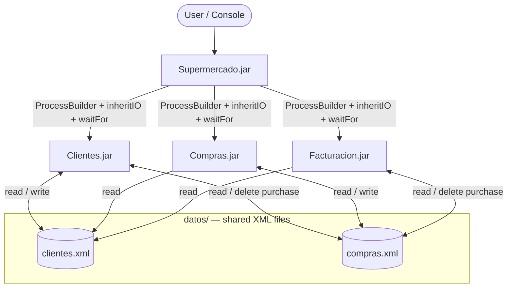

# Supermercado — Multi-Process Java Console System

> 🚧 **Work in Progress** — This project is currently under development. The features described below are **planned** and are being implemented step by step.

A console-based supermarket management system made of **four independent Java applications**. A main application launches the others as real operating-system processes, and they share data stored in two XML files.

---

## Table of Contents

- [Project Overview](#project-overview)
- [Project Objectives](#project-objectives)
- [Technologies](#technologies)
- [Main Features](#main-features)
- [Project Architecture](#project-architecture)
- [XML Data Storage](#xml-data-storage)
- [Installation and Execution](#installation-and-execution)
- [Screenshots](#screenshots)
- [Project Status](#project-status)
- [Author](#author)

---

## Project Overview

This is an academic intermodular project that combines two subjects:

- **Services and Processes Programming** — creating, running and controlling processes.
- **Data Access** — reading, writing and modifying XML files with the DOM API.

The system is designed for a supermarket chain that needs to register customers, manage their purchases and generate invoices. It is split into four independent console applications:

| Application      | Role |
|------------------|------|
| **Supermercado** | Main menu. Launches the other three applications as separate processes and waits for them to finish. |
| **Clientes**     | Registers, deletes and lists customers. |
| **Compras**      | Manages each customer's pending purchase: add, view, modify, delete and save products. |
| **Facturacion**  | Shows pending purchases, calculates totals and discounts, and confirms invoices. |

> Source code identifiers and console messages are written in Spanish, the language of the course.

---

## Project Objectives

- Create and control real operating-system processes from Java with `ProcessBuilder`.
- Share the console between the parent and child processes with `inheritIO()`.
- Wait for each child process with `waitFor()` and check its exit code.
- Create, read, update and delete XML data with the Java DOM API.
- Keep data persistent between executions.
- Validate user input so the applications do not stop unexpectedly.
- Perform accurate monetary calculations with `BigDecimal`.

---

## Technologies

| Technology | Usage |
|------------|-------|
| Java (JDK 26, targeting Java 21) | Programming language |
| Apache NetBeans 31 | IDE — four *Java with Ant* projects |
| Apache Ant | Build tool bundled with NetBeans |
| Java DOM API | `DocumentBuilderFactory`, `DocumentBuilder`, `Document`, `Element`, `NodeList`, `Transformer` |
| `ProcessBuilder` | Process creation and control |
| Git & GitHub | Version control |

No external libraries and no Maven: only the standard Java library.

---

## Main Features

> Planned features. Each item will be checked once it is implemented and tested.

### Supermercado (main application)
- [ ] Main menu that stays active until the user chooses to exit
- [ ] Launch `Clientes.jar`, `Compras.jar` and `Facturacion.jar` with `ProcessBuilder`
- [ ] Interactive console for child processes (`inheritIO()`)
- [ ] Wait for each process (`waitFor()`) and check its exit code
- [ ] Error handling when a JAR cannot be found or started
- [ ] Java executable resolved from `java.home` (no dependency on the system `PATH`)

### Clientes
- [ ] Register customers with an automatically generated unique ID
- [ ] Delete a customer (with confirmation) together with their pending purchase
- [ ] List registered customers

### Compras
- [ ] Select an existing customer and load their pending products
- [ ] Add, view, modify and delete products
- [ ] Price validation (greater than zero, maximum two decimals) and positive integer quantities
- [ ] Save the purchase without affecting other customers' data
- [ ] Warning about unsaved changes (save / discard / cancel)

### Facturacion
- [ ] Select a customer and view their pending purchase
- [ ] Calculate line amounts, subtotal, 10 % discount (subtotal ≥ 50 €) and final total
- [ ] Confirm the invoice and remove the pending purchase from `compras.xml`

---

## Project Architecture



All applications use the same common `datos` folder. Supermercado controls the processes, while Clientes, Compras and Facturacion read and modify the two shared XML files.

**Process flow**

1. The user starts `Supermercado.jar`.
2. When an option is selected, Supermercado starts the corresponding JAR as a new process.
3. The child process uses the same console, so the user interacts with it directly.
4. Supermercado waits until the child process ends, checks its exit code and shows the main menu again.

**Planned folder structure**

```
Supermercado-Java/
├── Supermercado/      # NetBeans project + Supermercado.jar
├── Clientes/          # NetBeans project + Clientes.jar
├── Compras/           # NetBeans project + Compras.jar
├── Facturacion/       # NetBeans project + Facturacion.jar
├── datos/             # Shared XML files
│   ├── clientes.xml
│   └── compras.xml
├── README.md
└── README.txt         # Execution instructions for the course
```

---

## XML Data Storage

All applications share two XML files located in the common `datos` folder. They are always accessed through the DOM API, never by string concatenation.

**`clientes.xml`** (example)

```xml
<?xml version="1.0" encoding="UTF-8"?>
<clientes>
    <cliente id="1">
        <nombre>Juan</nombre>
    </cliente>
</clientes>
```

**`compras.xml`** (example)

```xml
<?xml version="1.0" encoding="UTF-8"?>
<compras>
    <compra clienteId="1">
        <producto id="1">
            <nombre>Leche</nombre>
            <precio>1.20</precio>
            <cantidad>2</cantidad>
        </producto>
    </compra>
</compras>
```

**Storage rules**

- UTF-8 encoding.
- If a file does not exist, it is created with its root element.
- Each customer has at most one pending purchase.
- Prices are stored with a dot as decimal separator.
- Product IDs are unique within each customer's purchase.
- All applications find the same `datos` folder regardless of the directory they are run from.

---

## Installation and Execution

> ⚠️ These instructions are planned and **not yet verified**. They will be tested and completed when the JAR files are working.

**Requirements**

- Java Runtime 21 or later.

**Clone the repository**

```bash
git clone https://github.com/nataliekhuri/Supermercado-Java.git
cd Supermercado-Java
```

**Run (planned)**

```bash
java -jar Supermercado/Supermercado.jar
```

If `java` is not available in the system `PATH`, use the full path to the Java executable.

**Build from source (planned)**

Open each project in Apache NetBeans and run **Clean and Build**. The JAR file will be copied into its application folder.

---

## Screenshots

*Screenshots will be added once the applications are implemented.*

---

## Project Status

| Phase | Description | Status |
|-------|-------------|--------|
| 0 | Repository setup (`.gitignore`, `datos`, README) | 🔄 In progress |
| 1 | NetBeans projects and process control (`ProcessBuilder`) | ⏳ Pending |
| 2 | Clientes application | ⏳ Pending |
| 3–4 | Compras application | ⏳ Pending |
| 5 | Facturacion application | ⏳ Pending |
| 6 | Full testing | ⏳ Pending |
| 7 | Final delivery and documentation | ⏳ Pending |

---

## Author

**Natalie Khuri** — GitHub: [nataliekhuri](https://github.com/nataliekhuri)
